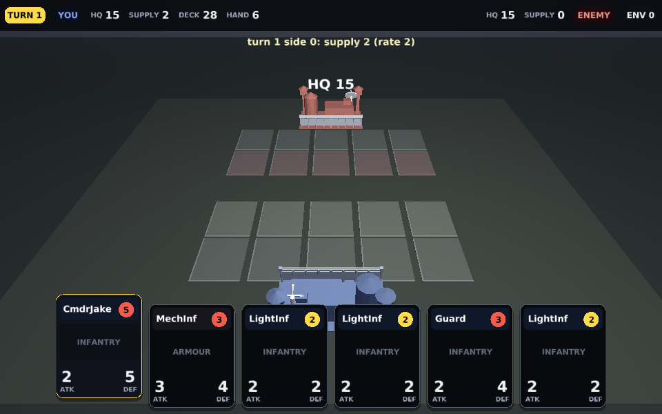

# Terra II

The original Terra II positional card game in a standalone 3D QOS Portable window, including its embedded unit meshes.

## Install and run

Tested with Homebrew FP-RISC 0.12.0 and QOS Portable 0.2.0 on macOS ARM64.

```sh
brew install hyperswine/tap/fprisc hyperswine/tap/qos-portable
git clone https://github.com/hyperswine/terra-ii.git
cd terra-ii
sol project.sol build
sol project.sol run
```

Enter starts/continues a game. Arrow keys move the cursor; Enter picks/confirms; Space or E ends the turn. A attacks, O overwatches, R retreats, V advances, C charges and F fires artillery. Escape cancels/pauses; P captures a frame; Q quits.

The upstream V1 rules and existing exclusions are retained. This extraction does not add card texts, the Unsupplied rule, RECALL, requisition or a mulligan.

FP-RISC 0.12.0's default optimization pipeline consumes excessive memory on this large game. The Sol build bounds the compiler heap to 2 GiB and disables optional specialization, inlining, reuse, vector and automatic region optimizations. Type, safety and linearity checks remain enabled.

## Test



```sh
sol project.sol test
```

The Sol GUI harness captures the original title and game screens, sends cursor/card/end-turn input, checks changed frames, and verifies a clean quit. It runs against a fresh temporary disk; screenshots and JSON results are retained under `evidence/`.

Builds can take several minutes for the larger applications. Build/test commands have explicit deadlines and return a failure when a child process fails. Generated binaries, caches, data, keys and raw logs are excluded from Git.

## Build tools

All project orchestration and test scripts are **Sol**. There are no Makefiles, Python or Node scripts.

The game is compiled with the installed `fpr`, linked by LLVM Clang/lld, and run by the installed native `qosp-gl`. The Sol ELF64/QAR2 packager constructs the runtime export table, validates AArch64 relocation types, checks a second link displaced by 256 MiB, hashes the image/relocations, and writes the archive. It invokes no `qos.py`, Python, Make, objcopy or readelf. Only the small pinned QOS app-side C ABI bridge is vendored; compiler/runtime/standard-library files come from the installed packages.

The Homebrew `qos-portable` formula itself still declares Python for its SDK CLI, but this project does not execute that CLI. Native compilation still requires Clang/lld and the platform toolchain. Standard filesystem utilities and a shell are used for directory/FIFO creation and descriptor plumbing; macOS `sips` exports test PNGs.

## Source and license

Extracted from [hyperswine/qos](https://github.com/hyperswine/qos/tree/7b5f9c122ada1fe429a865a0a48fdd59d2aa1e2f) at `7b5f9c122ada1fe429a865a0a48fdd59d2aa1e2f`. See [ORIGIN.md](ORIGIN.md) for the source map and local changes, and [LICENSE](LICENSE) for the upstream MIT license. No existing application data, private credentials, deployed host configuration or original source checkout is required.
